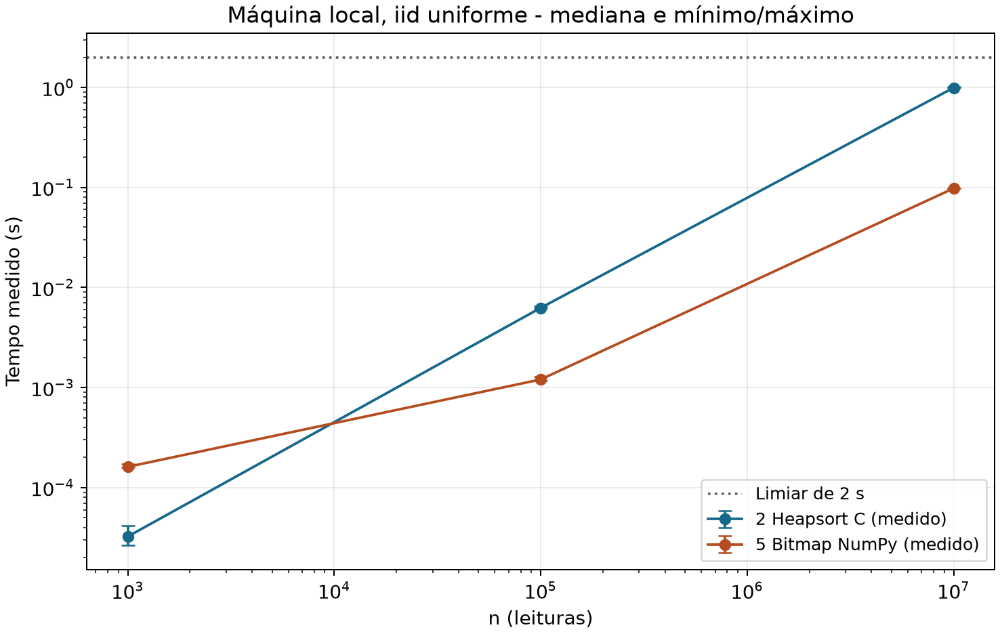
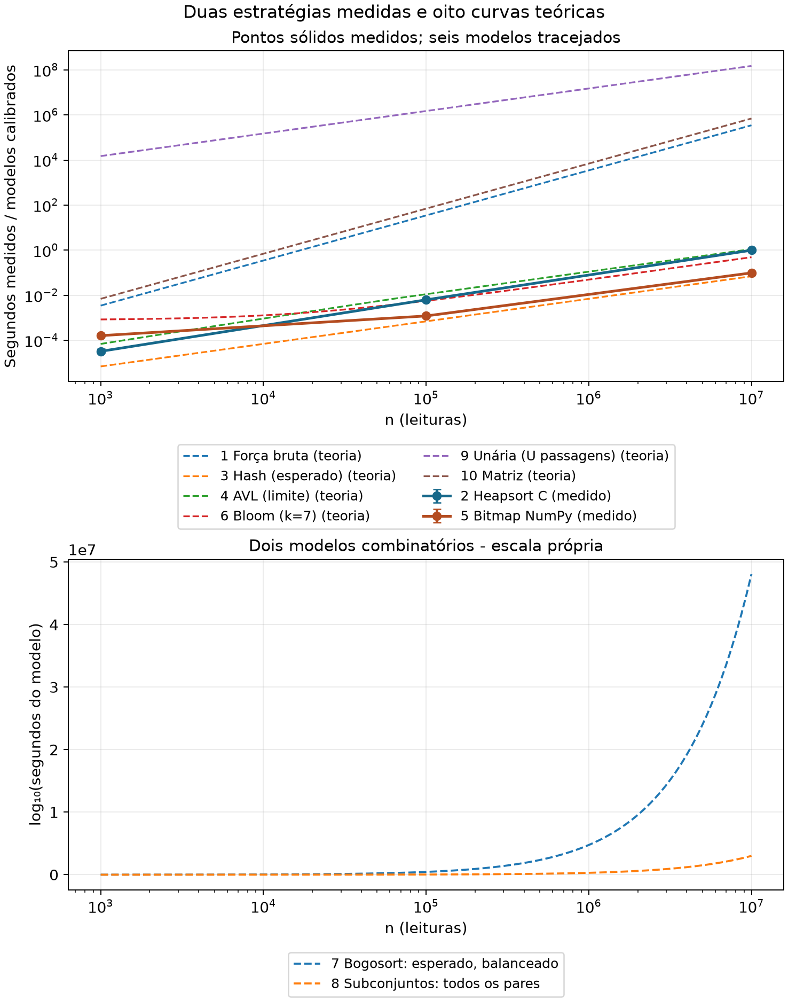

# Deduplicação de leituras de sensores — Complexidade de Algoritmos

Estudo e implementação de duas estratégias exatas para remover duplicatas de sequências de leituras `uint16` no domínio $U=65\,536$. As duas saídas são estritamente crescentes e contêm cada valor presente uma única vez. A análise compara **dez estratégias** quanto a tempo, espaço, corretude e adequação a dois cenários com restrições diferentes.

## Cenários e soluções

| Cenário | Estratégia selecionada | Critério de escolha |
|:--|:--|:--|
| Embarca | **2 — Heapsort iterativo em C** com compactação no próprio vetor | Entrada e saída no mesmo vetor, sem recursão nem alocação auxiliar; limite de 256 bytes adicionais sujeito a auditoria de ABI e build |
| Datacenter | **5 — Bitmap empacotado em Python/NumPy** com marcação em lotes | Deduplicação exata em $\Theta(n+U+d)$, bitmap de 8.192 bytes e enumeração crescente |

A entrada da Embarca utiliza $2n$ bytes, não incluídos nos 256 bytes extras. A saída da implementação C ocupa o prefixo do próprio vetor. O bitmap NumPy utiliza buffers temporários e nova saída, além de seus 8.192 bytes de payload.

## Arquivos da entrega

| Caminho | Conteúdo |
|:--|:--|
| [relatorio.pdf](relatorio.pdf) | Relatório acadêmico completo, com análise, figuras, dados e conclusões |
| [docs/analise_teorica.md](docs/analise_teorica.md) | Definições, deduções, melhor/médio/pior caso, corretude e memória das dez estratégias |
| [docs/resultados_empiricos.md](docs/resultados_empiricos.md) | Método, tabelas calculadas dos CSVs, gráficos, interpretação e limitações |
| [docs/codigo_comentado.md](docs/codigo_comentado.md) | Contratos, invariantes e listagens integrais dos dois códigos, comentadas em português |
| [src/embarcada_c/dedup.c](src/embarcada_c/dedup.c), [dedup.h](src/embarcada_c/dedup.h) | Implementação em C e interface da estratégia 2 |
| [src/datacenter_python/bitmap.py](src/datacenter_python/bitmap.py) | Implementação NumPy da estratégia 5 |
| [src/main.py](src/main.py) e [src/apoio/](src/apoio/) | Consulta, nova medição, compilação, instrumentação e geração de documentação |
| [tests/](tests/) | Testes de contrato, casos limites, domínio completo e índices repetidos |
| [dados/resultados_empiricos.csv](dados/resultados_empiricos.csv) | 190 observações históricas de tempo, com repetições, ambiente e hashes |
| [dados/medicoes_memoria.csv](dados/medicoes_memoria.csv) | 38 ensaios de memória vinculados às medições |
| [dados/resumo_empirico.csv](dados/resumo_empirico.csv), [avaliacao_bitmap.csv](dados/avaliacao_bitmap.csv) | Estatísticas por grupo e avaliação de lotes do bitmap |
| [dados/memoria_c.json](dados/memoria_c.json) e [auditoria_c/](dados/auditoria_c/) | Evidências históricas de pilha e código de máquina do build C auditado |
| [dados/custos_teoricos.csv](dados/custos_teoricos.csv) e [calculos_sympy.json](dados/calculos_sympy.json) | Modelos teóricos identificados e conferências exatas |
| [figuras/tempos_medidos.png](figuras/tempos_medidos.png), [comparacao_completa.png](figuras/comparacao_completa.png) | Observações locais e comparação com oito curvas teóricas |
| [latex/relatorio.tex](latex/relatorio.tex), [latex/secoes/](latex/secoes/) | Arquivos-fonte complementares do relatório (consulta opcional) |
| [requirements.txt](requirements.txt), [.gitignore](.gitignore) | Dependências Python registradas e exclusões de build/execuções |

## Ambiente experimental histórico

- **CPU:** AMD Ryzen 5 5600 (6 núcleos); **sistema:** Windows 11 Pro x64, versão 10.0.26300.
- **Linguagem e compilador:** C11, GCC 16.2.0 (`x86_64-w64-mingw32`), `-O2`, `-fno-builtin`, `-fno-stack-protector` e flags de diagnóstico; Python 3.12.5.
- **Bibliotecas:** NumPy 2.1.2, Matplotlib 3.11.1, SymPy 1.14.0 e mpmath 1.3.0.
- **Experimento:** semente `20261111`, tamanhos de 1.000, 100.000 e 10.000.000, cinco repetições por combinação após aquecimento completo; seis distribuições e caso sem duplicatas apenas em $n=1.000$.

Este é o ambiente dos **resultados históricos**, não uma especificação de desempenho de outras máquinas. O código organizado nesta entrega também foi compilado e testado em um ambiente Linux separado, com GCC, Python 3.13 e NumPy 2.3.5; seus tempos não substituem os valores históricos e o novo pacote **não foi novamente testado em Windows**.

## Instalação, compilação e execução

Os comandos abaixo pressupõem execução a partir da raiz da pasta distribuída, Python disponível no terminal e um GCC no `PATH`. Para instalar as versões Python usadas no experimento histórico, recomenda-se Python 3.12.5 e:

```bash
python -m pip install -r requirements.txt
```

Compilar a biblioteca C localmente e executar os nove testes:

```bash
python src/apoio/compilar_c.py
python -m unittest discover -s tests -v
```

A compilação gera uma biblioteca dinâmica e objetos temporários em `.build/`, ignorada pelo Git; não há vínculo com DLLs de outra pasta. O compilador usa a extensão de biblioteca adequada ao sistema identificado. Esses comandos foram exercitados no ambiente Linux de verificação. Em Windows, é necessário colocar uma instalação de GCC adequada no `PATH`; a recompilação desta distribuição no Windows ainda não foi verificada.

Para **consultar os dados históricos** sem executar algoritmos ou modificar CSVs:

```bash
python src/main.py --mostrar
```

Para **realizar novas medições**, com ambas as estratégias em todos os tamanhos e distribuições, e gravar os resultados em uma pasta distinta:

```bash
python src/main.py --medir --repeticoes 5 --saida .execucoes/ensaio-01
```

Se `--saida` for omitido, cria-se uma pasta nova com data e hora em `.execucoes/`. O comando recusa sobrescrever um diretório já existente e impede gravação dentro de `dados/`. Para um teste rápido: `python src/main.py --medir --tamanhos 1000 --distribuicoes iid_uniforme --repeticoes 1 --saida .execucoes/teste-curto`. É possível ler uma execução própria com `python src/main.py --mostrar --origem .execucoes/ensaio-01`. O ensaio C é destrutivo sobre a cópia de trabalho, preparada fora do cronômetro.

O cronômetro (`perf_counter_ns`) **inclui** inicialização de auxiliares, execução, produção da saída e a fronteira Python/ctypes. Exclui geração/cópia da entrada, ponteiro, oráculo, validação, impressão e instrumentação de memória. Os ensaios de memória são separados; todas as saídas são validadas fora do cronômetro. Cada nova medição registra hashes dos fontes atuais; os hashes históricos dos CSVs originais permanecem inalterados.

## Resultados empíricos históricos

Medianas dos cinco tempos em cada cenário, distribuição **iid uniforme** (segundos, máquina local):

| n | Heapsort C: mediana (s) | Bitmap NumPy: mediana (s) |
|--:|--:|--:|
| 1.000 | 0.0000324 | 0.0001612 |
| 100.000 | 0.0062543 | 0.0012042 |
| 10.000.000 | 0.9910261 | 0.0979133 |



Em 1.000 leituras, a estratégia C teve menor latência; em 100.000 e 10.000.000, a estratégia bitmap apresentou menores medianas. No tamanho máximo, as diferenças de distribuição foram especialmente relevantes para o heapsort: entradas com todos os elementos iguais e entradas alternadas têm comportamento distinto da entrada iid. O bitmap mantém tempos mais próximos nas diferentes distribuições, mas inclui a inicialização e a enumeração do domínio inteiro.

O maior tempo do bitmap entre as **30 observações locais** com $n=10^7$ foi **0.1026721 s**. Isso é inferior ao limiar de 2 s nessa máquina e nessa série histórica, mas não garante o mesmo resultado na máquina de referência.

### Evidências de memória

No objeto C historicamente auditado, foram documentados 56 bytes para pilha/retorno, mais 32 bytes de espaço de chamada Win64 e 16 bytes de margem conservadora: **104 bytes adicionais**, com heap auxiliar zero e estático gravável zero. A evidência é específica do **build GCC/Win64 inspecionado**; não é medição de RSS, de um sensor real ou do binário recompilado em outro ambiente.

O bitmap usa **8.192 bytes de payload**. Com lotes de 65.536 leituras, a marcação utiliza até 204.800 bytes de payload explícito somando bitmap, índices e máscaras. A produção de saída utiliza buffers transitórios; o pico registrado em um ensaio de domínio completo foi **730.080 bytes**, incluindo os temporários rastreados e a saída. `tracemalloc` não é uma medida exaustiva da memória nativa do processo, e não equivale a RSS ou a heap auxiliar isolado.

A comparação gráfica abaixo mantém duas séries realmente observadas e oito modelos teóricos. A constante comum de escala para as oito curvas é somente uma convenção de visualização; não foram realizados benchmarks dos outros algoritmos.



## Limitações

A coleta histórica reflete uma máquina, uma semente e cinco repetições por combinação. Frequência, afinidade, caches e processos em segundo plano não foram controlados. A medição da pilha C é uma auditoria estática contextualizada pela ABI; o bitmap tem temporários e memória nativa parcialmente fora do rastreamento. **Não houve ensaio na máquina de referência nem no alvo embarcado**. As linhas teóricas representam funções de custo com unidades diferentes e não são tempos medidos.

As fontes originais historicamente medidas foram preservadas por seus hashes nos CSVs e no [`metodo_benchmark.json`](dados/metodo_benchmark.json); a revisão de comentários não reatribui as medições a uma versão posterior. Informações complementares estão nos [resultados completos](docs/resultados_empiricos.md), na [análise teórica](docs/analise_teorica.md) e no [relatório PDF](relatorio.pdf).
