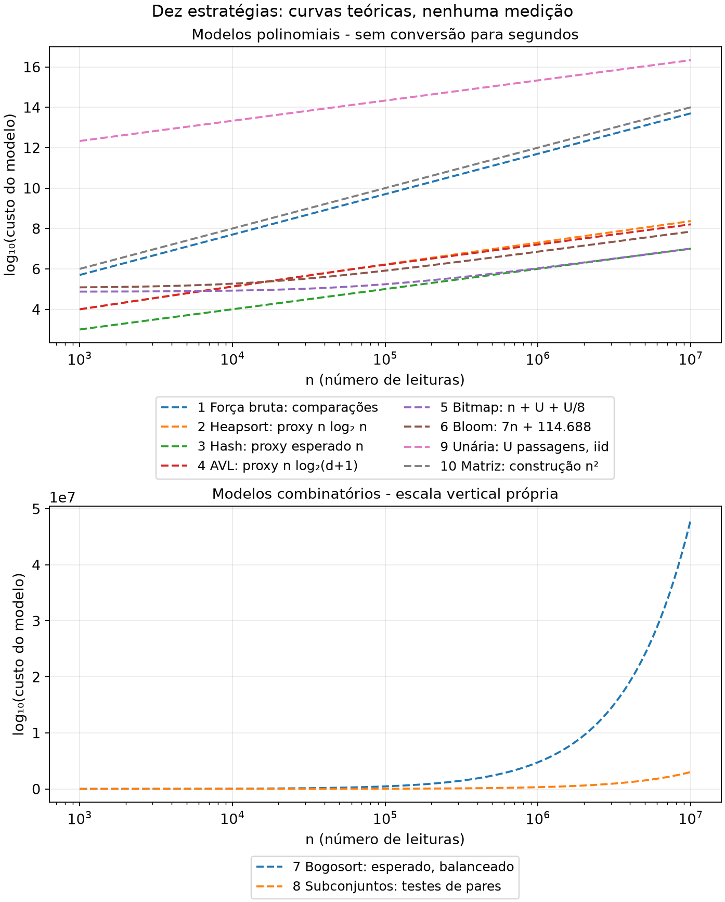
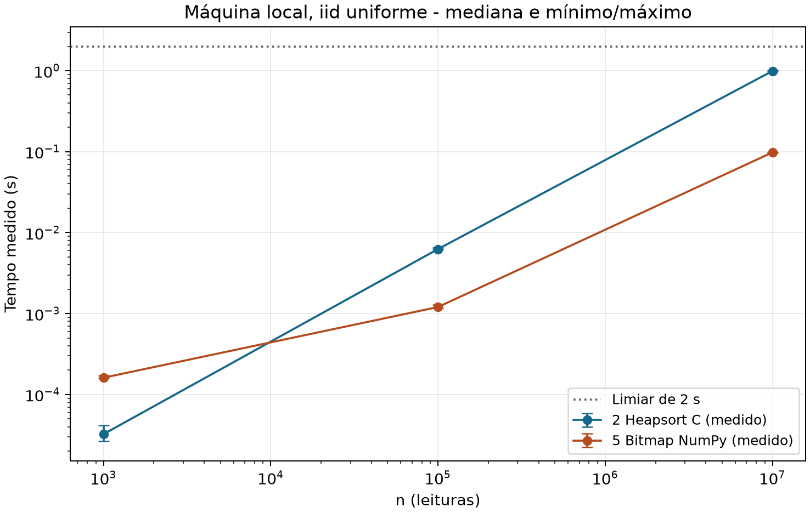
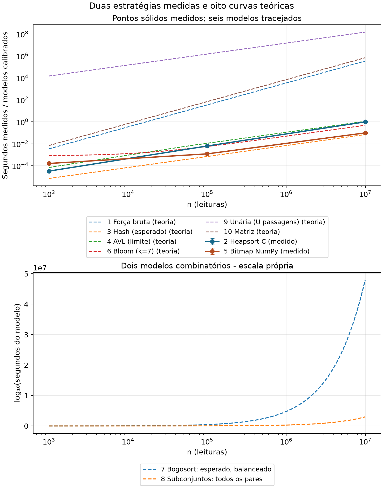

# Estado e escopo

O usuário adotou o par 2/5 como decisão técnica da equipe e autorizou a
implementação local em 11/11/2026, com saída crescente nas duas versões.
Foram implementados heapsort iterativo e compactação em C, e bitmap
empacotado em Python/NumPy. Os testes e 190 observações locais de tempo,
com 38 ensaios separados de memória, estão registrados nos dados.

O enunciado [E], seções 3 e 4.3, exige aprovação prévia do professor; essa
aprovação continua sem registro. A autorização de continuidade veio do
usuário e não é apresentada como aprovação docente. O requisito acadêmico
permanece pendente. Não houve contato com o professor. O histórico da
decisão está em `docs/proposta_par.md`. Os resultados locais não comprovam
o prazo na máquina de referência da disciplina ou o orçamento em um sensor
com compilador/ABI diferentes.

# Problema, hipóteses e modelo de custo

Sejam $n\in\mathbb N$, admitindo $n=0$, $U=65\,536=2^{16}$ e
$A=(a_0,\ldots,a_{n-1})\in\{0,\ldots,U-1\}^n$. Seja

$$D(A)=\{x\mid \exists i<n:\ a_i=x\},\qquad d=|D(A)|\le\min(n,U).$$

Produzir uma sequência $B$ sem repetições tal que seu conjunto de elementos
seja $D(A)$. Cada valor presente aparece uma única vez, mesmo que originalmente
ocorra uma vez só. O enunciado não exige estabilidade; por decisão da equipe,
as duas implementações entregam B estritamente crescente. As oito outras
estratégias são analisadas com a ordem própria de suas variantes e não foram
implementadas. Para $n=0$, a resposta é vazia.

Adotamos RAM de palavras suficientes para índices até n, operações com uma
leitura de 16 bits em O(1), acesso à memória O(1) e hashes de chaves de 16 bits
em O(1). Resultados assintóticos usam n ≥ 1, e logaritmos de custos podem ser
escritos como $\log_2(n+1)$ para evitar logaritmo de zero. A entrada compacta
residente ocupa $2n$ bytes: 2.000, 200.000 e 20.000.000 bytes nas três escalas.
Essa entrada não integra os 256 bytes extras da Embarca.

Se a saída for armazenada separadamente em uint16, ocupa $2d$ bytes, até
131.072 bytes; se for um fluxo, usa somente um buffer constante; se for o
prefixo da entrada, não cria segundo payload. Listas e inteiros Python têm
cabeçalhos e referências: seu custo não é $2n$. Separaremos sempre entrada,
saída, heap auxiliar, pilha e disco. Salvo menção explícita, não há disco
auxiliar. O espaço de pilha é contado em palavras; bytes concretos dependem
da ABI, compilador e frames realmente simultâneos.

Com U variável, hash e árvores armazenam d chaves, e bitmap tem Θ(U) bits.
Com U fixo, Θ(U) é constante em n, mas continua sendo 8.192 bytes: notação
assintótica não elimina um limite físico. Em particular, entradas sem
duplicatas só existem para n ≤ U; não serão prometidas para n = 10⁵ ou 10⁷.

Melhor e pior caso são mínimo e máximo sobre entradas de mesmo tamanho. Caso
médio exige uma distribuição: usaremos explicitamente permutações uniformes
de chaves distintas (somente n ≤ U), leituras iid uniformes no domínio, ou
aleatoriedade dos hashes/embaralhamentos, conforme indicado. Amortização é
uma garantia sobre sequências, não uma hipótese probabilística [A2, A3].

# Estratégia 1: força bruta

**Operação adotada.** Para cada i, comparar $a_i$ com cada um dos i valores do
prefixo original, acumulando um indicador de igualdade sem interromper o
laço. Emitir $a_i$ somente quando nenhuma igualdade foi encontrada. A entrada
é somente leitura e a saída pode ser um fluxo em ordem de primeira aparição.
Essa versão deliberadamente completa evita ambiguidade entre varrer todo o
prefixo original e varrer apenas o conjunto compacto de valores distintos.

**Contagem e casos.** Cada par de posições é examinado exatamente uma vez:

$$C(n)=\sum_{i=0}^{n-1}i=0+1+\cdots+(n-1)=\frac{n(n-1)}2.$$

Pareando a soma em ordem direta e reversa, $2C(n)=n(n-1)$. Alternativamente,
$C(0)=0$ e $C(n+1)=C(n)+n=n(n+1)/2$, completando a indução. O controle dos
laços acrescenta Θ(n). Melhor, médio sob qualquer distribuição e pior caso
são Θ(n²) para esta versão; a fórmula, portanto, vale também no pior caso,
mesmo quando n > U. Em n = 10⁷, são 49.999.995.000.000 comparações.
Mesmo uma taxa hipotética de 10⁹ comparações/s daria 49.999,995 s, cerca de
13,89 horas. Isso é conversão de um modelo, não tempo medido.

**Variantes.** Interromper na primeira igualdade dá melhor caso Θ(n), com
todas iguais; o pior continua Θ(n²) mesmo para U = 2: uma primeira metade de
zeros seguida de uns força a segunda metade a alcançar a posição do primeiro
um. A contagem triangular exata para essa variante é atingida por chaves
distintas quando n ≤ U; para n > U é apenas limite superior, não máximo exato.
Comparar somente com os d valores distintos já compactados tem limite
O(n min(n,U)), outra implementação que não deve ser confundida com a adotada.

**Espaço e corretude.** Heap zero, pilha Θ(1), entrada 2n, saída 2d ou fluxo,
disco zero. O indicador é verdadeiro se e somente se existe posição anterior
igual; logo cada valor é emitido exatamente na primeira posição. O índice i
cresce e cada laço interno é finito. Exata e determinística. Cabe na classe de
memória pretendida pela Embarca, mas 256 bytes exigiriam inspeção concreta;
não atende a perspectiva de tempo do Datacenter no modelo ilustrativo.

# Estratégia 2: ordenação e varredura

**Operação implementada.** Heapsort iterativo sobre o próprio vetor: construir um
max-heap de baixo para cima, trocar a raiz pelo último elemento da parte ativa,
reduzir essa parte e restaurar o heap por descida iterativa. Depois escrever
no prefixo da entrada o primeiro elemento e cada valor diferente do anterior.
Comparar com o último valor já escrito, em posição anterior à leitura.
Retornar o tamanho lógico
d. A ordem torna-se crescente; não preserva as posições originais.

**Derivação.** A construção custa
$O(\sum_{h\ge0}nh/2^{h+1})=O(n)$, porque a soma geométrica ponderada é finita
(igual a 1 sem o fator n). Há n−1 extrações, cada qual com no máximo
$\lfloor\log_2 n\rfloor$ níveis; a varredura custa Θ(n). Portanto
$T(n)=O(n)+O(n\log n)+\Theta(n)=O(n\log n)$.

Para a descida usual que para se o pai já domina os filhos, todas iguais
custam Θ(n), o melhor caso admitindo repetições. O pior caso é Θ(n log n).
Sob permutações uniformes de n chaves distintas, o médio é Θ(n log n), para
n ≤ U. Para iid no domínio fixo usamos apenas os limites seguros
$\Omega(n)\le E[T]\le O(n\log n)$; não transferimos a prova de chaves
distintas para n > U. Uma versão que sempre desce até folha tem outros
detalhes no melhor caso. Não atribuímos a ela custos da versão proposta.

**Sorts alternativos.** Quicksort com partição binária clássica custa
Θ(n log n) com divisões equilibradas; com pivôs uniformes e chaves distintas,
o esperado decorre de
$E[T(n)]=\frac2n\sum_{j=0}^{n-1}E[T(j)]+\Theta(n)$.
Não é uma igualdade de recorrência de caso médio assumir sempre duas metades
exatas. O pior satisfaz $T(n)=T(n-1)+\Theta(n)=\Theta(n²)$.
Heap auxiliar zero, mas pilha recursiva Θ(log n) em divisões equilibradas e
Θ(n) no pior caso da versão ingênua. Recursar só na menor parte e iterar na
maior limita a pilha a O(log n), ainda dependente de n. Repetições podem
produzir o pior caso em partições de duas vias; três vias requer outra análise.
Mergesort convencional sem atalhos satisfaz
$T(n)=2T(n/2)+\Theta(n)=\Theta(n\log n)$ nos três casos, heap Θ(n), pilha
Θ(log n) na versão recursiva ou Θ(1) na versão bottom-up. Não se confunde com
mergesort in-place sofisticado. qsort não oferece aqui uma caracterização de
memória suficiente para a escolha embarcada.

**Espaço e provas.** Heapsort iterativo: heap zero, pilha Θ(1), entrada 2n,
saída no prefixo sem payload adicional, disco zero. Na construção, os filhos
de cada nó já são heaps; a descida restaura a propriedade no nó sem alterar
o multiconjunto. Na extração, o sufixo contém os maiores elementos em ordem,
e o prefixo ativo continua um heap. Seu tamanho diminui até zero. Por indução,
o vetor final está ordenado e é permutação da entrada. Na compactação, após
ler i posições, o prefixo escrito contém um representante de cada bloco
igual já lido. Em vetor ordenado, todas as ocorrências iguais são contíguas,
portanto o resultado é exatamente D(A). O ponteiro de escrita nunca ultrapassa
o de leitura; nenhuma posição futura é destruída. Para n = 0, retornar zero
antes de acessar a primeira posição ou decrementar índices sem sinal.

**Clientes.** É a escolha Embarca: limite assintótico garantido e ausência de
heap ou recursão. O relatório GCC e a inspeção do objeto sustentam 104 bytes
extras como limite conservador neste build x64; os detalhes estão nos resultados
locais. Isso não é uma medição em sensor não disponibilizado. Para n = 10⁷,
$n\log_2 n\approx2,32535\cdot10^8$ unidades de crescimento, contra cerca de
10⁷ acessos do bitmap; as constantes diferem e isso não prevê segundos.
O Datacenter pode usá-la, mas o domínio sugere uma alternativa linear.

# Estratégia 3: tabela hash

**Operação.** Consultar um conjunto com encadeamento e inserir/emitir somente
chaves ausentes. Comparar chaves completas em colisões. Redimensionar por
fator geométrico para manter carga $\alpha=d/b$ limitada, sendo b o número
de buckets. A saída emitida preserva a primeira aparição.

**Casos e hipóteses.** Com hashing uniforme simples, carga limitada, custo
O(1) para calcular hash e sequência não adaptativa à semente, consulta e
inserção esperadas custam O(1+α). Cópias nos crescimentos somam
$1+2+\cdots+2^r<2^{r+1}$, dando custo total O(d) amortizado para reconstruir,
se a função hash puder ser avaliada em tempo constante. Logo melhor Θ(n) e
esperado Θ(n). Isso não é garantia determinística: todas as chaves no mesmo
bucket dão O(n d), até Θ(n²) quando d = n ≤ U. Para n > U, uma cadeia com
Θ(U) chaves consultada repetidamente dá Θ(nU); portanto a expressão mais
informativa é pior Θ(n min(n,U)), na família de tabelas descrita. Com U
constante, é O(n), mas com constante potencialmente 65.536 comparações por
consulta. Rehashing não resolve uma função adversarial constante.

**Espaço, prova e clientes.** Heap Θ(d+b) palavras e pico ainda Θ(d) em
crescimentos geométricos, pilha Θ(1) se iterativo; entrada 2n, saída 2d ou
fluxo; disco zero. Invariante: o conjunto armazena precisamente D do prefixo
lido; comparações completas impedem que colisões causem erro. Exata; tempo
e distribuição interna podem ser aleatórios, mas não o conjunto de saída.
Mesmo o payload de todas as chaves requer 131.072 bytes, sem buckets; viola
256 bytes para entradas suficientemente diversas. É boa opção Datacenter,
mas o bitmap usa uma indexação exata sem buckets nem hipóteses de colisão.

# Estratégia 4: árvore binária balanceada

**Operação.** Uma AVL ou Red-Black guarda um nó por valor distinto. Buscar
cada leitura; inserir com rebalanceamento e emitir se ausente. Consultas e
rotações iterativas com ponteiros de pai evitam pilha dependente da altura.
Não estamos analisando uma árvore binária sem balanceamento.

**Casos.** Uma AVL de altura h tem pelo menos
$N(h)=1+N(h-1)+N(h-2)$ nós; a recorrência cresce como Fibonacci, logo
h = O(log(d+1)). Buscar/inserir custa O(log(d+1)), e rotações preservam essa
altura. Melhor Θ(n), com uma única chave repetida. Médio Θ(n log n) para
permutação uniforme de n distintos; para iid no domínio, garantimos
O(n log(min(n,U)+1)), sem depender da distribuição. O pior na família é
Θ(n log(min(n,U)+1)); para U fixo, O(n), com até cerca de dezenas de níveis,
e não um log n ilimitado. Se n ≤ U e d = Θ(n), recupera Θ(n log n).

**Espaço e corretude.** Heap Θ(d) nós; pilha Θ(1) com ponteiros de pai
(incluídos nos nós), ou O(log(d+1)) na variante recursiva. Entrada 2n, saída
2d/fluxo, disco zero. Cada busca segue a propriedade de ordem; as rotações
preservam o percurso em ordem e o conjunto de chaves, logo vale o mesmo
invariante de prefixo do hash. Exata e determinística. Uma representação
ilustrativa com chave, dois filhos, pai e metadados pode ocupar 32 bytes por
nó numa ABI de 64 bits, não uma medição: 2.097.152 bytes para U nós, fora
overhead do alocador. Inadequada à Embarca; o Datacenter ganha garantia de
busca, mas não precisa da manutenção de ordem para este problema.

# Estratégia 5: bitmap exato

**Operação implementada.** Zerar U bits, armazenados em 8.192 bytes uint8.
Para x, marcar o bit r do byte q, com $q=\lfloor x/8\rfloor$ e $r=x\bmod8$.
Como $0\le q<8.192$ e $0\le r<8$, cada valor tem endereço válido exclusivo.
Lotes de c = 65.536 valores usam índices uint16 e máscaras uint8. A chamada
`numpy.bitwise_or.at(bitmap, indices, masks)` acumula todas as máscaras para
cada índice, incluindo índices de byte repetidos. A operação avançada
`bitmap[indices] |= masks` não tem essa garantia, pois usa buffering [NP].
Após marcar, `unpackbits(bitorder='little')` e `flatnonzero` enumeram as
posições marcadas do domínio em ordem crescente; os índices são convertidos
para uint16. Não se usa set, sort, unique ou histograma no algoritmo.

**Casos e espaço.** Zerar custa Θ(U/8) acessos a bytes; processar custa Θ(n),
varrer bits custa Θ(U) e emitir d valores custa Θ(d). Melhor, médio
(qualquer distribuição) e pior Θ(n+U+d). O bitmap requer $\lceil U/8\rceil$
bytes. O heap adicional inclui Θ(min(n,c)) de buffers de lote e Θ(U+d) de
temporários de emissão, além da saída de 2d bytes e dos cabeçalhos. Com U e
c fixos, esses payloads são constantes em n; não são só os 8 KiB do bitmap.
Pilha Θ(1) em profundidade, sem contagem completa dos bytes de pilha de
Python/NumPy; entrada 2n, saída separada de 2d, disco zero. Como 8 divide U,

$$\frac U8=\frac{65\,536}8=8\,192\ \text{bytes}=8\ \text{KiB},\qquad
\frac{8\,192}{256}=32.$$

O ndarray do bitmap acrescenta cabeçalho, alocação e temporários: 8.192 é seu
payload, não RSS nem total do processo. Uma representação alternativa em
inteiro Python requer análise de custo das operações sobre inteiros grandes;
não se deve supor que cada OR copie só um byte.

**Prova e decisão.** Antes da posição i, o bit x vale 1 se e somente se x
ocorreu em A[0:i]. Inicialmente nenhum valor ocorreu e todos os bits são zero.
O passo faz OR com a máscara correspondente; OR é associativo, comutativo e
idempotente, portanto acumular um lote sem buffering produz o mesmo bitmap
que executar todos os passos escalares, mesmo com vários bits no mesmo byte.
Ao fim, os bits marcados são exatamente D(A). A enumeração percorre os
índices 0 a U−1; cada marcado aparece uma vez e em ordem crescente.
Cada laço tem limite finito. Determinística e exata. Rejeitada para Embarca
por fator 32 de memória antes mesmo dos temporários. A versão NumPy processou
10⁷ em menos de dois segundos em todas as 30 observações locais; a máquina
de referência da disciplina permanece sem verificação.

# Estratégia 6: filtro de Bloom

**Operação e erro.** Um filtro com m bits zerados e k hashes informa
"possivelmente visto" quando todos os k bits consultados estão marcados.
Para cada leitura, consultar e depois marcar seus bits sempre, mesmo se a
consulta for positiva; emitir somente nas consultas negativas. Não há falsos
negativos de pertinência para itens inseridos, sem remoções. Entretanto, um
falso positivo na primeira ocorrência suprime um valor válido da saída;
não significa inserir um valor inexistente nem apenas classificar mal um
duplicado. A saída aproximada pode omitir elementos de D(A). Repetições
futuras do mesmo valor suprimido não reparam essa omissão.

**Fórmula usual e dimensionamento.** Para t valores distintos inseridos,
hashes uniformes independentes, uma posição permanece zero com probabilidade
$(1-1/m)^{kt}$. Aproximando a dependência entre posições consultadas e usando
$(1-1/m)^{kt}\approx e^{-kt/m}$,

$$p_t\approx\left(1-(1-1/m)^{kt}\right)^k
\approx(1-e^{-kt/m})^k.$$

A primeira fórmula ainda usa aproximação de independência dos bits, não é
uma igualdade exata geral do Bloom convencional. Para capacidade t ≤ D,
minimizar o modelo exponencial em k dá a condição
$\ln(1-e^{-u})+u e^{-u}/(1-e^{-u})=0$, com $u=kD/m$.
Sua solução minimizante é $u=\ln2$ (para k real positivo); substituindo,

$$k_*=(m/D)\ln2,\quad p_*\approx e^{-(m/D)(\ln2)^2},\quad
m\ge-\frac{D\ln p_*}{(\ln2)^2}.$$

Com $p_*=1/100$ e D = U, o limite contínuo é aproximadamente 628.166,386 bits,
ou 9,58506 bits/chave; k* ≈ 6,64386. Arredondar k para 7 muda o modelo.
Para esse k, dimensionar novamente por

$$m_7=\left\lceil\frac{-7D}{\ln(1-(1/100)^{1/7})}\right\rceil.$$

Isso fornece m₇ = 628.684 bits, ou 78.586 bytes empacotados, e taxa
aproximada 0,00999999095 no modelo exponencial. Os valores estão em
`dados/calculos_sympy.json`. O payload supera o bitmap exato de 8.192 bytes.
Dimensionar com D = 10⁷ seria desperdício: nunca há mais de U distintos.

**Uma garantia de no máximo 1%.** Para não vender uma aproximação como
garantia, considerar Bloom particionado: k = 7 blocos independentes com
b = 2D bits cada e um hash uniforme por bloco. A consulta a um valor ainda
não inserido tem, no modelo de hashes plenamente independentes,

$$p_t=\left[1-(1-1/b)^t\right]^7
\le(t/b)^7\le(1/2)^7=1/128<1/100.$$

A desigualdade usa a união dos t eventos de colisão em cada bloco; a
independência entre blocos permite multiplicar. O payload é
$m=7(2D)=14D$ bits = 114.688 bytes para D = U. É uma garantia probabilística
por consulta inédita sob o modelo declarado; não garante que ≤1% dos valores
sejam omitidos em toda execução finita. Implementações reais de hash e
sementes exigiriam validação desse modelo.

**Taxa empírica.** Consultar cada valor distinto somente na sua primeira
ocorrência para essa estatística, usando oráculo exato fora do filtro. Se Q
é o número desses valores distintos testados ainda não vistos, definir
$\widehat p=FP/Q$, onde FP conta consultas positivas nessa população.
Se Q = 0, registrar "não aplicável", não dividir por zero. Não dividir por n,
pois repetições não são testes negativos e diluiriam artificialmente a taxa.
Falsos positivos de consultas separadas não precisam ser independentes.

**Casos e recursos.** Sem atalhos nos k hashes, os três casos são
Θ(m/8+nk+d_saida); k constante dá Θ(n+m/8). Heap Θ(m/8) bytes, pilha Θ(1),
entrada 2n, saída até 2d (aproximada), disco zero. Sem uma distribuição de
hashes não há significado para a taxa esperada, embora o custo continue
limitado. Uma semente fixada torna o resultado reproduzível, não exato.
Com somente 256 bytes e D = U, m = 2.048 bits: até k = 1 dá
$p\approx1-e^{-32}$, praticamente 1. O modelo ótimo contínuo daria k* < 1,
que não é um número válido de hashes. Para 1% e k = 7 no modelo usual,
256 bytes comportariam apenas cerca de 213 distintos. Não atende à Embarca
no domínio inteiro; para Datacenter é inferior ao bitmap em correção e
payload. A exceção probabilística do enunciado não obriga escolher Bloom.

# Estratégia 7: bogosort e varredura

**Operação.** Verificar se A está ordenado; caso contrário, fazer Fisher-Yates
iterativo uniforme in-place e repetir. Após obter ordem crescente, compactar
vizinhos como na estratégia 2. Supor embaralhamentos independentes e acesso
a inteiros aleatórios uniformes em custo esperado constante. O estado do
gerador é constante em n, mas seus bytes precisam entrar no orçamento real.

Se os valores têm multiplicidades $c_1,\ldots,c_d$, com $\sum c_j=n$,
há $\prod_j c_j!$ permutações de posições correspondentes à única sequência
de valores ordenada. Assim a chance por embaralhamento é

$$q=\frac{\prod_j c_j!}{n!},\qquad
E[X]=1/q=\frac{n!}{\prod_j c_j!}.$$

Para uma entrada inicialmente desordenada, X é geométrica: a esperança é
finita mas não existe máximo finito se q < 1. Cada tentativa custa Θ(n)
por causa do embaralhamento, mesmo que o teste de ordem termine cedo.
Melhor caso Θ(n), já ordenado; para entrada desordenada fixa, tempo esperado
Θ(n/q). Sob permutação inicial uniforme do mesmo multiconjunto, a ordem de
esperança é Θ(n/q) quando q está separado de 1; todas iguais dão Θ(n).
Pior caso não limitado: uma sequência infinita de falhas tem probabilidade
zero sob o modelo ideal, mas para todo limite finito há chance de excedê-lo.
Não há garantia de prazo. No caso de n distintos, E[X] = n! e tempo
esperado Θ(n n!), somente possível se n ≤ U.

Para n = 1.000 distintos, $1000!\approx4,0238726\cdot10^{2567}$ tentativas.
Não se deve estender a hipótese de 10⁷ distintos ao domínio de 16 bits.
Para os três tamanhos obrigatórios usamos o multiconjunto válido balanceado
entre d = min(n,U) chaves: escrever n = ad+r, 0 ≤ r < d. Então

$$E[X]=\frac{n!}{((a+1)!)^r(a!)^{d-r}}.$$

Seu logaritmo decimal é calculado sem construir esse inteiro gigantesco;
as aproximações de $\log_{10}E[X]$ são:

| n | d | $\log_{10} E[X]$, aproximado |
|--:|--:|--:|
| 1.000 | 1.000 | 2.567,604644 |
| 100.000 | 65.536 | 446.198,753129 |
| 10.000.000 | 65.536 | 48.067.060,787435 |

O logaritmo do modelo de trabalho nE[X] no CSV acrescenta $\log_{10}n$.
Stirling dá
$\ln(n!)\approx n\ln n-n+\tfrac12\ln(2\pi n)$, com correção $1/(12n)$
quando usada. As estimativas são modelos, não execuções de bogosort.

Heap zero, pilha Θ(1), entrada 2n, saída compactada no prefixo, disco zero.
Correto quando termina porque somente permutações são feitas e a varredura
é correta; a terminação é quase certa, não limitada. Embarca não tem um prazo
numérico no enunciado: a rejeição por latência é de engenharia, não violação
de um limite de tempo especificado para esse cliente. Viola o objetivo do
Datacenter por expectativa astronômica. Para n ≤ 3 ou todas iguais deixa de
ser uma catástrofe assintótica, mas não oferece vantagem operacional.

# Estratégia 8: enumeração recursiva de subconjuntos

**Definição precisa.** Enumerar os $2^n$ subconjuntos dos índices da entrada
por decisão incluir/excluir em cada nível. Para cada subconjunto S, percorrer
todos os seus elementos e todos os seus pares para verificar se seus valores
são distintos. Entre os válidos, escolher um de cardinalidade máxima; empates
podem usar ordem lexicográfica dos índices. A enumeração não para cedo e os
testes de pares não interrompem. A saída escolhida preserva a ordem dos
índices, podendo selecionar outras ocorrências que não as primeiras.

Um subconjunto válido contém no máximo um índice por valor, logo tem tamanho
≤ d. Existe um de tamanho d escolhendo uma ocorrência de cada valor. Portanto
o máximo produz exatamente D(A). A recursão termina porque a profundidade
cresce até n, e cobre todos os subconjuntos por indução incluir/excluir.

**Contagens.** A árvore de geração tem $2^{n+1}-1$ nós. Só gerar descritores
pode custar Θ(2ⁿ), mas materializar os elementos custa

$$\sum_{s=0}^n s\binom ns=n2^{n-1}.$$

Cada índice participa de metade dos subconjuntos. Cada par participa de um
quarto, de modo que verificar todos os pares custa, para n ≥ 2,

$$\sum_{s=0}^n\binom s2\binom ns=\binom n2\,2^{n-2}.$$

Logo o algoritmo completo adotado tem melhor, médio e pior Θ(n²2ⁿ),
independentemente dos valores. Declarar apenas O(2ⁿ) ocultaria o custo de
percorrer os elementos e testar a propriedade pedida. Se usar outro teste
linear, o custo seria Θ(n2ⁿ), não o da variante especificada.

**Espaço.** Materialização: heap Θ(n2ⁿ) palavras de índices, não só Θ(2ⁿ)
descritores; pilha Θ(n) palavras. Geração sob demanda: caminho corrente em
pilha Θ(n) e melhor subconjunto guardado em heap O(n), sem guardar todos;
o tempo dos testes permanece Θ(n²2ⁿ). Entrada 2n, saída 2d/fluxo, disco zero
salvo materialização externa explícita. Se a saída usa a própria lista do
melhor subconjunto, não contá-la duas vezes. Exata e determinística.

Em n = 50, as quantidades exatas são:

$$2^{50}=1.125.899.906.842.624\quad\text{subconjuntos},$$

$$50\cdot2^{49}=28.147.497.671.065.600\quad\text{ocorrências de índices}.$$

Com 8 bytes
por índice, apenas o payload materializado exige 225.179.981.368.524.800
bytes (200 PiB). A 10⁹ subconjuntos/s hipotéticos, só visitá-los leva cerca
de 13,03 dias, ainda sem os testes, que fazem 344.806.846.470.553.600
comparações de pares. Uma pilha ilustrativa de 32 bytes por nível daria
1.600 bytes já em n = 50 e 320 MB em n = 10⁷. Não são frames medidos.
Inadequada aos dois clientes; em instâncias minúsculas ou quando todos os
subconjuntos são realmente a saída, a enumeração pode fazer sentido.

# Estratégia 9: codificação unária em disco

**Representação.** Codificar cada x como $1^x0$ em arquivo de bits empacotados.
O zero separador representa também x = 0, sem ambiguidade. O comprimento é

$$L(A)=\sum_{i=0}^{n-1}(a_i+1)=n+\sum_i a_i\ \text{bits},\qquad
\text{bytes}=\lceil L(A)/8\rceil.$$

Escrever o arquivo e o decodificar custam Θ(L+n) operações de bits e Θ(L/8)
bytes transferidos em cada passagem completa. Isso sozinho ainda não
deduplica. Para definir uma solução completa de RAM constante, fazer, para
cada x do domínio, uma passagem pelo arquivo decodificando os n registros;
emitir x uma vez se presente. Essa variante tem saída crescente, um contador
de corrida, um indicador, um índice e buffers fixos. Não guarda U contadores.

**Casos e I/O.** O tempo completo é Θ(U(L+n)) = Θ(UL) para n ≥ 1.
Melhor, todas zero: L = n, tempo Θ(Un). Para leituras iid uniformes,
$E[L]=n(1+(U-1)/2)=n(U+1)/2$, e $E[T]=\Theta(nU²)$ no modelo de bits.
Pior, todas U−1: L = nU, tempo Θ(nU²). Disco auxiliar Θ(L/8) bytes; heap
zero se buffers fixos, pilha Θ(1), entrada 2n, saída 2d/fluxo. O I/O de
payload é uma escrita e U leituras: $(U+1)\lceil L/8\rceil$ bytes, sem
metadados. A transferência pode ser mais eficiente que operar bit a bit,
mas isso não elimina as U passagens. Buffers do SO/cache e da biblioteca
não são automaticamente cobertos por uma afirmação de RAM ≤256 bytes.

Para n = 10⁷ e todas 65.535: L = 655.360.000.000 bits, ou
81.920.000.000 bytes (81,92 GB decimais), 32.768 vezes os 2n bytes da entrada.
No uniforme, E[L]/8 = 40.960.625.000 bytes antes do arredondamento; essa
expectativa de bits dividida por oito difere da esperança do teto em menos
de um byte. A variante de passagens completas lê 5.368.709.120.000.000 bytes
no pior caso, além da escrita. A uma taxa ideal de 10⁹ bytes/s, só leituras
levariam cerca de 62,14 dias. São hipóteses de I/O, não medições.

**Correção e clientes.** Cada registro tem um único separador e uma contagem
de uns, tornando a decodificação injetiva. Em cada passagem, o indicador x
fica verdadeiro se e somente se há registro de x; emitir cada x no máximo
uma vez resolve o problema. Todos os laços têm limites finitos. A solução
é exata e determinística. Não existe crescimento exponencial em n com U
fixo: $n\le L\le nU$, logo L = Θ(n). Em modelo de entrada binária com largura
w variável, valores até $2^w-1$ podem usar Θ(n2^w) bits unários; isso é
exponencial em w, não em n. A tabela do enunciado chama o disco de
"exponencial"; mantemos o modelo explícito e corrigimos essa classificação.
Rejeitada no Datacenter por I/O e nas condições embarcadas pela necessidade
de disco, latência e buffers não demonstrados, embora os escalares sejam
O(1). Para valores muito pequenos, arquivo já unário ou uso didático, sua
representação pode ser aceitável, sem justificar estas U passagens.

# Estratégia 10: matriz de adjacência de auditoria

**Operação.** Criar matriz densa n×n sobre posições, não sobre valores:
$M_{ij}=1$ se $a_i=a_j$. Preencher todas as entradas, mesmo que a simetria
permita economias. Para cada i, emitir $a_i$ se não há 1 em j < i, percorrendo
todo esse prefixo sem interrupção. A saída preserva a primeira aparição.

Construção faz n² testes de igualdade; a leitura triangular acrescenta
n(n−1)/2 testes de bits. Melhor, médio e pior são Θ(n²), porque a construção
é obrigatória. Heap n² bytes se cada célula for uint8, ou $\lceil n²/8\rceil$
bytes com bits empacotados; pilha Θ(1), entrada 2n, saída 2d/fluxo, disco zero
se tudo em RAM (ou o mesmo payload em disco se explicitamente mapeado).
Não são listas Python de bool, que teriam outra representação.

Para n = 10⁷: $n²=10^{14}$ células; 100.000.000.000.000 bytes = 100 TB
decimais com bytes, ou 12.500.000.000.000 bytes = 12,5 TB com bits.
Mesmo n = 1.000 requer 1.000.000 bytes ou 125.000 bytes respectivamente,
ambos muito maiores que 256. Uma triangular empacotada reduziria cerca de
metade, sem mudar Θ(n²). Com 10⁹ testes/s hipotéticos, somente construir
leva 100.000 segundos, cerca de 27,78 horas.

Por definição, um 1 antes da diagonal equivale exatamente a uma ocorrência
anterior; daí a mesma prova da força bruta. Exata, determinística e finita.
Inadequada aos dois clientes para deduplicação; em pequenos n e uma tarefa
que realmente solicite todas as relações de igualdade para auditoria, poderia
ser justificável. O enunciado atual não solicita essa matriz.

# Síntese comparativa e recomendação

Os limites da tabela resumem as variantes acima. H é heap auxiliar e P é
pilha; entrada e saída seguem as convenções anteriores. Use d ≤ min(n,U).

| Estratégia | Tempo relevante | H | P |
|:--|:--|:--|:--|
| 1. Força bruta completa | Θ(n²), todos os casos | 0 | Θ(1) |
| 2. Heapsort iterativo | melhor Θ(n); pior Θ(n log n) | 0 | Θ(1) |
| 3. Hash encadeado | esperado Θ(n); pior Θ(n min(n,U)) | Θ(d) | Θ(1) |
| 4. AVL iterativa | melhor Θ(n); pior Θ(n log(min(n,U)+1)) | Θ(d) | Θ(1) |
| 5. Bitmap NumPy | Θ(n+U+d), todos | Θ(U+min(n,c)+d) bytes | Θ(1) em profundidade |
| 6. Bloom | Θ(m/8+nk), todos | Θ(m/8) bytes | Θ(1) |
| 7. Bogosort | esperado Θ(n/q); pior ilimitado | 0 | Θ(1) |
| 8. Subconjuntos, teste completo | Θ(n²2ⁿ), todos | Θ(n2ⁿ) materializado | Θ(n) |
| 9. Unária, U passagens | Θ(UL), conforme valores | 0, buffer fixo | Θ(1) |
| 10. Matriz densa | Θ(n²), todos | Θ(n²) bits/bytes | Θ(1) |

Para Embarca, adotar heapsort e compactação: elimina alocação e recursão,
reutiliza a entrada e reduz o crescimento quadrático. O bitmap exato já
excede o orçamento por fator 32; hash e árvores dependem de d; Bloom de
256 bytes não suporta o domínio com 1%; as quatro estratégias exageradas
desperdiçam tempo, disco ou memória. A evidência em bytes está no build local,
com limite conservador de 104 bytes, não no alvo embarcado ainda desconhecido.

Para Datacenter, adotar bitmap empacotado e emissão crescente: custo Θ(n)
com U fixo, 8 KiB de bitmap e temporários explicitados, resultado exato.
Hash tem hipóteses e pior caso de
colisões; AVL/ordenação acrescentam trabalho; Bloom perde valores e ocupa
mais memória que o bitmap no dimensionamento para todo o domínio. Há evidência
local de execução abaixo de dois segundos, sem teste na referência da disciplina.

# Modelos quantitativos e figuras

`src/apoio/analise_simbolica.py` usa SymPy 1.14.0 para conferir a soma
triangular, as contagens de elementos e pares nos subconjuntos, a série de
alturas do heap, o dimensionamento Bloom, o bitmap, o disco e a matriz.
As provas em prosa precedem a confirmação algébrica; a saída de software
não as substitui. Resultados exatos e aproximações são guardados separadamente
em `dados/calculos_sympy.json`. A tabela `dados/custos_teoricos.csv` tem tipo
`teorico`, unidades e hipóteses explícitas para n = 10³, 10⁵, 10⁷.

O eixo vertical mostra $\log_{10}$ de uma quantidade de trabalho de cada
modelo, não segundos. O painel polinomial contém 1, 2, 3, 4, 5, 6, 9, 10;
o painel combinatório separa 7 e 8 para que não tornem os demais ilegíveis.
Usamos: força bruta n(n−1)/2; heapsort n log₂n como proxy de pior caso;
hash n como proxy esperado; AVL n log₂(min(n,U)+1) como limite; bitmap
n+U+U/8; Bloom 7n+14U/8, versão particionada; unária Un(U+1)/2 para iid
uniformes, operações de bits; matriz n², preenchimento; subconjuntos
$\binom n2 2^{n-2}$, testes de pares; bogosort n vezes o multinomial
balanceado. Unidades primitivas e constantes não são intercambiáveis:
o gráfico mostra crescimento, sem inferir ranking de segundos. Para curvas
coincidentes há sobreposição indicada nas legendas.

Para bogosort, os logs usam log-gamma com precisão ampliada; para o power
set usam logaritmos sem gerar subconjuntos. Não houve simulação dos métodos
absurdos. Valores exibidos são aproximações dos logs das expressões exatas.

O gráfico combinado adiante contém as duas séries medidas e oito linhas
teóricas. A calibração é declarada com a constante e o ponto de referência;
seu compartilhamento entre algoritmos é uma convenção visual, não uma
previsão validada dos tempos de cada método. A unária também envolve I/O,
que tem custos distintos de acessos em RAM.

# Método experimental executado

O protocolo está em `docs/plano_experimental.md`. A rotina
`src/apoio/benchmark.py` executou ambas as estratégias em n = 10³, 10⁵ e 10⁷,
com cinco repetições de iid uniforme, todas iguais, alternada de fronteiras,
ciclo do domínio, ordenada e reversa. O caso sem duplicatas foi medido em
n = 1.000; não existe para n > U. São 19 conjuntos de entrada, 38 combinações
com estratégia e 190 tempos. Semente: 20261111. Hashes SHA-256 de entradas,
fontes e DLL identificam exatamente os dados e o código medidos.

O cronômetro `perf_counter_ns` inclui inicialização dos auxiliares e produção
da saída. Exclui geração/cópia da entrada, conversão do ponteiro ctypes,
oráculo, validação, impressão e profiler. As chamadas Python/ctypes entram
no tempo observado. Houve um aquecimento de entrada completa por combinação.
A cópia para C é refeita antes de cada repetição, pois seu vetor é modificado.
O bitmap lê a entrada sem alterá-la. Ambas as saídas são uint16 crescentes.

Os oráculos manuais foram executados. A suíte de nove testes também cobre
364 sequências exaustivas curtas, 40 entradas aleatórias, guardas de fronteira
de escrita, domínio completo embaralhado e repetido, contrato de tipos,
entrada nula/vazia e acumulação de bits no mesmo byte. Um oráculo com
`numpy.unique` é usado somente fora do algoritmo e do cronômetro. Os 190
resultados de benchmark também foram comparados a esse oráculo, incluindo
ordem estritamente crescente. Não foram implementadas as outras oito
estratégias. A comparação escalar/NumPy é entre variantes da mesma estratégia 5.

<!-- BEGIN_RESULTADOS_LOCAIS -->

# Resultados locais e evidências

Ambiente: Ryzen 5 5600, Windows 11 Pro x64 (10.0.26300), Python 3.12.5, NumPy 2.1.2 e GCC 16.2.0. São 190 tempos em cinco repetições de 38 combinações de tamanho, distribuição e estratégia; há 38 ensaios de memória separados. Todas as 190 saídas foram conferidas com oráculo independente, fora da região cronometrada.

## Tempos com leituras iid uniformes

| n | Heapsort C: mediana (s) | Bitmap NumPy: mediana (s) |
|--:|--:|--:|
| 1.000 | 0.0000324 | 0.0001612 |
| 100.000 | 0.0062543 | 0.0012042 |
| 10.000.000 | 0.9910261 | 0.0979133 |

Valores decimais com ponto. Os dados brutos preservam todas as repetições, e `resumo_empirico.csv` inclui mínimos, máximos e desvio padrão amostral. Não se trata de intervalo de confiança.

## Todas as distribuições em n = 10⁷

| Entrada | C: mediana (s) | Bitmap: mediana (s) | Bitmap: máximo (s) |
|:--|--:|--:|--:|
| iid uniforme | 0.9910261 | 0.0979133 | 0.0987172 |
| todas iguais | 0.0272650 | 0.0975739 | 0.0988469 |
| alternada fronteiras | 0.1812792 | 0.0974607 | 0.0988012 |
| ciclo dominio | 0.6974604 | 0.0980160 | 0.1002473 |
| ordenada | 0.3561650 | 0.0975463 | 0.0980108 |
| reversa | 0.4209251 | 0.0978913 | 0.1026721 |

O maior tempo das 30 observações do bitmap em n = 10⁷ foi **0.1026721 s**, inferior a 2 s na máquina local. Isso satisfaz o limiar nesta amostra local; não é garantia universal de prazo nem comprovação na máquina de referência da disciplina, que não foi disponibilizada.

## Evidência de memória da Embarca

O GCC reportou **56 bytes** de pilha estática para a única função do algoritmo. A desmontagem confirma seis pushes de registradores (48 bytes) e endereço de retorno (8 bytes), sem chamadas internas nem ajuste adicional de rsp. As versões instrumentada e normal têm código de máquina idêntico. Reservando ainda 32 bytes de home space do chamador Win64 e 16 bytes conservadores de alinhamento, o limite é

$$S_{\mathrm{extra}} \le 56+32+16+0_{\mathrm{heap}}+0_{\text{estático}}=104\ \text{bytes}<256.$$

As seções .data e .bss do objeto do algoritmo têm tamanho zero. Contadores de malloc, calloc, realloc e free registraram zero chamadas e zero bytes solicitados em todos os tamanhos e distribuições. Um controle positivo em DLL separada detectou uma tentativa de 17 bytes, evitando uma instrumentação que sempre retorna zero. O objeto não tem símbolos indefinidos e a função não chama rotinas externas; assim também se confere a ausência de alocações ocultas nesse objeto.

Esse é um **limite estático conservador do build local x64**, conferido com relatórios e instruções, não uma leitura dinâmica da pilha nem RSS. Não inclui entrada/saída aliasada, código de máquina, metadados somente de leitura do objeto, Python/ctypes, CRT, SO ou interrupções. Os contadores pertencem ao aparato de auditoria, não ao objeto do algoritmo. Outra ABI, compilador ou sensor exige repetir essa auditoria.

## Temporários e seleção do bitmap

A avaliação em `avaliacao_bitmap.csv` mediu a versão escalar e lotes NumPy de 4.096, 65.536, 1.048.576 e 10.000.000 elementos: três tempos e um ensaio de memória por variante, todos iid com n = 10⁷. O lote de 65.536 foi escolhido pelo equilíbrio entre tempo e memória; a variante integral não foi escolhida só por ser marginalmente mais rápida.

| Variante | Mediana local (s) | Pico rastreado (bytes) |
|:--|--:|--:|
| escalar | 1.7139402 | 185705 |
| numpy lote 4096 | 0.1160033 | 730080 |
| numpy lote 65536 | 0.0984213 | 730080 |
| numpy lote 1048576 | 0.0979594 | 3225392 |
| numpy lote 10000000 | 0.0951859 | 30079664 |

Para c = 65.536, a marcação mantém bitmap de 8.192 bytes, índices uint16 de 2c bytes e máscaras uint8 de c bytes, total de payload explícito 204.800 bytes. As fatias são views, não cópias. Os dois buffers saem de escopo antes da emissão. Esta usa U bytes de flags, até 8d bytes de índices intp e 2d bytes de saída; seu pico simultâneo de payload é

$$8\,192+65\,536+8d+2d\le729\,088\ \text{bytes}.$$

O ensaio com domínio completo registrou pico **730.080 bytes**, incluindo a saída de 131.072 bytes e cabeçalhos/temporários rastreáveis. Não se subtrai a saída do pico para inventar um pico auxiliar, pois os máximos podem ocorrer em instantes diferentes. `medicoes_memoria.csv` separa payloads analíticos, pico rastreado e tamanho da saída. Um probe de 1.000.000 bytes de NumPy produziu 1.000.096 bytes rastreados, confirmando que esta distribuição registra seus buffers de dados no tracemalloc. Esse profiler cobre Python e alocações NumPy registradas, não toda a pilha ou todo buffer nativo interno; não é RSS nem medida exaustiva do processo.

## Duas medições e oito extrapolações

A calibração visual usa n₀ = 100000, a mediana medida do bitmap T₀ = 0.0012042 s e f₅(n₀) = n₀ + U + U/8 = 173728. Para cada uma das oito estratégias não implementadas, a linha é $\widehat T_j(n)=T_0 f_j(n)/f_5(n_0)$. A constante comum é aproximadamente 6.93152514e-09 s/unidade. Trata-se de uma convenção para sobreposição gráfica, sem validação das constantes de cada algoritmo. Comparações, hashes e bits de I/O são unidades distintas. Em particular, linhas de unária e métodos combinatórios não são tempos observados ou previsões calibradas por execuções desses métodos.

Para 7 usa-se n vezes o multinomial balanceado do domínio; para 8, binomial(n,2)2^(n−2). O logaritmo é avaliado sem construir esses objetos. As expressões exatas estão na análise e no CSV teórico. A faixa combinatória exige exibir log₁₀ dos segundos modelados, pois converter números com milhões de dígitos para float estouraria.

## Limitações experimentais

Uma máquina, uma semente, cinco repetições e processos de fundo não controlados não demonstram comportamento em todos os hardwares. Afinidade, frequência e caches não foram fixados. Houve um aquecimento de entrada completa por combinação. Em n pequeno, FFI e inicialização de domínio influenciam o resultado: o bitmap não precisa ser o mais rápido em n = 1.000. O heapsort varia bastante conforme as repetições dos valores, coerente com o melhor caso linear de todas iguais. Memória e tempo foram medidos em invocações separadas; o cronômetro inclui inicialização dos auxiliares e construção da saída, mas exclui geração/cópia de entrada, oráculo, impressão e profiler.

<!-- END_RESULTADOS_LOCAIS -->

# Ambiente e formalização

O inventário reproduzível está em `docs/ambiente.json`. Inicialmente:
Python 3.12.5, NumPy 2.1.2, Matplotlib 3.11.1, pypdf 7.0.0 e Poppler
25.07.0. SymPy 1.14.0 e mpmath 1.3.0 foram instalados somente em
`.tools/python`, sem alterar a instalação global. Compiladores gcc, clang
e cl não foram encontrados inicialmente no PATH. Foi preparado GCC 16.2.0
(w64devkit 2.11.0), alvo x86_64-w64-mingw32, dentro de `.tools/`. O comando
de compilação usa C11, -O2, avisos tratados como erros, -fno-builtin,
-fno-stack-protector, -fstack-usage e -fcallgraph-info=su. Os comandos completos
e relatórios estão em `dados/auditoria_c/`. Também foram
preparados Pandoc 3.13 e Tectonic 0.17.0 em `.tools/`, com cache TeX dentro
da raiz. O LaTeX foi compilado e suas páginas foram renderizadas com Poppler
para revisão visual. As fontes Windows Cambria, Calibri e Consolas são
dependências explícitas; outro ambiente requer as mesmas fontes ou adaptação.
A ausência de um comando no PATH não prova ausência
em todo o disco; é o escopo desta detecção.

Lean, Lake e elan não foram localizados no PATH. Não havia lean-toolchain,
lakefile ou lake-manifest, nem Mathlib configurada neste projeto. A skill
lean4-doctor orientou esse diagnóstico; as referências opcionais em
vendor/lean4-plugin estão ausentes. Não foram criados arquivos Lean nem
alegada verificação formal. A skill lean4-checkpoint foi lida, mas o build
e a auditoria nativa de axiomas não puderam ser executados sem a ferramenta.
Não há declarações locais para listar; a ausência de fontes Lean não é
uma auditoria de axiomas bem-sucedida. As skills de formalização/prova ficam
condicionadas a uma ferramenta utilizável; não são substituídas por uma
skill de aprendizado. Os candidatos úteis seriam a soma triangular e
$8\cdot8192=65536$, sem formalizar segundos de hardware.

# Limites atendidos e pendências

O par 2/5 está implementado, testado e medido localmente, com saída crescente.
O limite de 256 bytes é atendido pelo limite conservador do objeto C local
(104 bytes); requer nova auditoria no compilador e ABI do sensor. O bitmap
teve todas as 30 observações em n = 10⁷ abaixo de 2 s localmente; a máquina
de referência da disciplina permanece sem teste. A aprovação docente
continua sem registro, apesar da autorização local do usuário. Lean/Lake
não estão disponíveis no diagnóstico e nenhuma prova formal foi reivindicada.
O checklist em `docs/checklist_requisitos.md` distingue essas situações.

# Fontes e rastreabilidade

Todos os arquivos de entrada foram preservados; os hashes SHA-256 estão em
`docs/entradas_sha256.json`. As referências a páginas usam a numeração física
do PDF, que pode diferir do número impresso no slide.

- **[E]** `statement/PjBL_Complexidade_Algoritmos-1.pdf`, 5 páginas.
  Restrições e catálogo na p. 2; aprovação nas pp. 1 e 3; entregáveis e
  validação nas pp. 3-4.
- **[A1]** Felipe A. Przysiada, `learning_references/A 01 - Aula Inaugural-1 (1).pdf`,
  42 páginas. Contagem de comparações (pp. 16-21), modelo e definição do
  problema (pp. 28-37).
- **[A2]** Felipe A. Przysiada, `learning_references/A02 - Casos (1).pdf`,
  44 páginas. Melhor/pior/médio (pp. 5-10 e 25-28), amortização (pp. 30-36).
- **[A3]** Felipe A. Przysiada, `learning_references/A03 - Notação Assintotica.pptx (1).pdf`,
  48 páginas. O, Ω, Θ e limites (pp. 5-12, 17-29 e 34-42).
  A conversão de 2⁵⁰ operações a 10⁹/s na p. 42 contém um erro numérico:
  equivale a aproximadamente 13,03 dias, não 35 mil anos. A conta aqui é
  refeita em unidades explícitas, sem repetir o erro.
- **[A4]** Felipe A. Przysiada, `learning_references/A04 - Corretude e Inducao (1).pdf`,
  44 páginas. Invariantes e término (pp. 11-20), somas/indução (pp. 24-40).
- **[N8, N9]** URLs de Aula 08 (substituição) e Aula 09 (árvore de recursão
  e Teorema Mestre) listadas em `learning_references/notion_links.txt`.
  Ambas foram consultadas pela ferramenta web em 11/11/2026, que retornou
  indisponibilidade. Seus conteúdos não foram obtidos nem usados como
  evidência. Consultar `docs/leitura_materiais.md` para os links completos.
- **[S]** SymPy 1.14.0, documentação oficial:
  <https://docs.sympy.org/latest/index.html>. Ferramenta de conferência, não
  fonte da demonstração de corretude.
- **[NP]** NumPy 2.1, `ufunc.at`, documentação oficial:
  <https://numpy.org/doc/2.1/reference/generated/numpy.ufunc.at.html>.
  Acumulação sem buffering nos índices repetidos. Consultada em 11/11/2026.
- **[GCC]** GCC, *Developer Options*, documentação oficial:
  <https://gcc.gnu.org/onlinedocs/gcc/Developer-Options.html>.
  Relatórios de grafo de chamadas e uso de pilha. Os bytes são conferidos
  também na desmontagem deste build, não inferidos somente da documentação.
- **[SK]** Timothy Kassis, Vinayak Agarwal, Yuhuan He, Darshil Patel e Aubrey
  M. Brueckner (2026). *Scientific Agent Skills: A Library of Procedural
  Knowledge for Research Agents*. arXiv:2609.00065,
  <https://doi.org/10.48550/arXiv.2609.00065>. Metadados consultados no registro
  <https://arxiv.org/abs/2609.00065> em 11/11/2026: versão corrente v2, sem
  referência de publicação em periódico no registro. A skill SymPy 1.5
  contribuiu para o procedimento de verificação simbólica.

