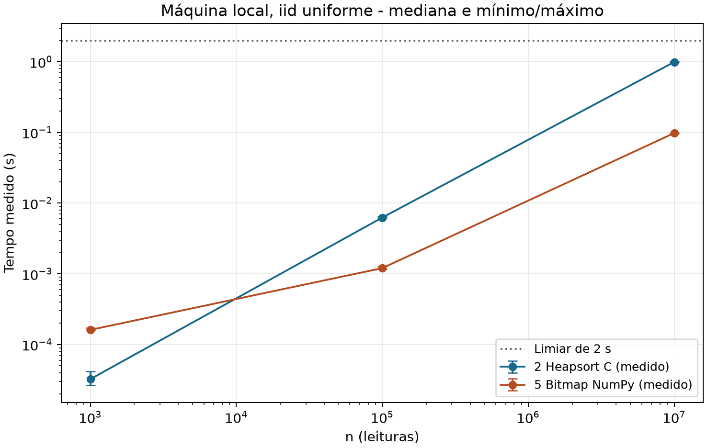
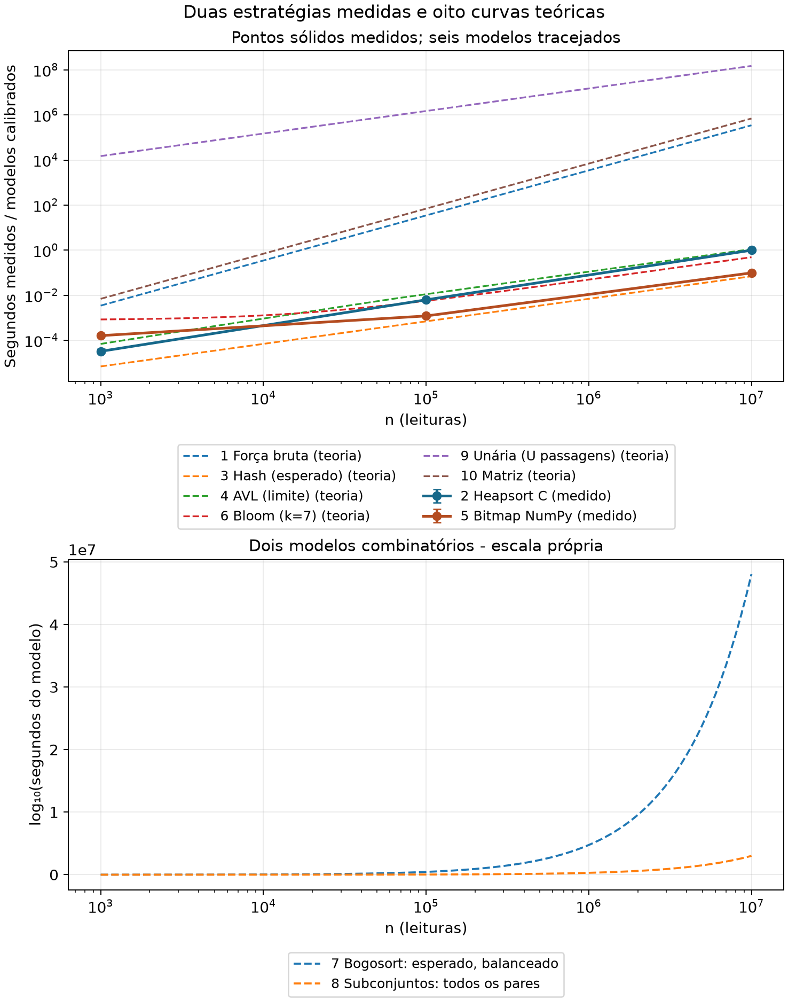

# Resultados locais e evidências

Ambiente: Ryzen 5 5600, Windows 11 Pro x64 (10.0.26300), Python 3.12.5, NumPy 2.1.2 e GCC 16.2.0. São 190 tempos em cinco repetições de 38 combinações de tamanho, distribuição e estratégia; há 38 ensaios de memória separados. Todas as 190 saídas foram conferidas com oráculo independente, fora da região cronometrada.

## Tempos com leituras iid uniformes

| n | Heapsort C: mediana (s) | Bitmap NumPy: mediana (s) |
|--:|--:|--:|
| 1.000 | 0.0000324 | 0.0001612 |
| 100.000 | 0.0062543 | 0.0012042 |
| 10.000.000 | 0.9910261 | 0.0979133 |

Valores decimais com ponto. Os dados brutos preservam todas as repetições, e `resumo_empirico.csv` inclui mínimos, máximos e desvio padrão amostral. Não se trata de intervalo de confiança.

## Todas as distribuições em n = 10⁷

| Entrada | C: mediana (s) | Bitmap: mediana (s) | Bitmap: máximo (s) |
|:--|--:|--:|--:|
| iid uniforme | 0.9910261 | 0.0979133 | 0.0987172 |
| todas iguais | 0.0272650 | 0.0975739 | 0.0988469 |
| alternada fronteiras | 0.1812792 | 0.0974607 | 0.0988012 |
| ciclo dominio | 0.6974604 | 0.0980160 | 0.1002473 |
| ordenada | 0.3561650 | 0.0975463 | 0.0980108 |
| reversa | 0.4209251 | 0.0978913 | 0.1026721 |

O maior tempo das 30 observações do bitmap em n = 10⁷ foi **0.1026721 s**, inferior a 2 s na máquina local. Isso satisfaz o limiar nesta amostra local; não é garantia universal de prazo nem comprovação na máquina de referência da disciplina, que não foi disponibilizada.

## Evidência de memória da Embarca

O GCC reportou **56 bytes** de pilha estática para a única função do algoritmo. A desmontagem confirma seis pushes de registradores (48 bytes) e endereço de retorno (8 bytes), sem chamadas internas nem ajuste adicional de rsp. As versões instrumentada e normal têm código de máquina idêntico. Reservando ainda 32 bytes de home space do chamador Win64 e 16 bytes conservadores de alinhamento, o limite é

$$S_{\mathrm{extra}} \le 56+32+16+0_{\mathrm{heap}}+0_{\text{estático}}=104\ \text{bytes}<256.$$

As seções .data e .bss do objeto do algoritmo têm tamanho zero. Contadores de malloc, calloc, realloc e free registraram zero chamadas e zero bytes solicitados em todos os tamanhos e distribuições. Um controle positivo em DLL separada detectou uma tentativa de 17 bytes, evitando uma instrumentação que sempre retorna zero. O objeto não tem símbolos indefinidos e a função não chama rotinas externas; assim também se confere a ausência de alocações ocultas nesse objeto.

Esse é um **limite estático conservador do build local x64**, conferido com relatórios e instruções, não uma leitura dinâmica da pilha nem RSS. Não inclui entrada/saída aliasada, código de máquina, metadados somente de leitura do objeto, Python/ctypes, CRT, SO ou interrupções. Os contadores pertencem ao aparato de auditoria, não ao objeto do algoritmo. Outra ABI, compilador ou sensor exige repetir essa auditoria.

## Temporários e seleção do bitmap

A avaliação em `avaliacao_bitmap.csv` mediu a versão escalar e lotes NumPy de 4.096, 65.536, 1.048.576 e 10.000.000 elementos: três tempos e um ensaio de memória por variante, todos iid com n = 10⁷. O lote de 65.536 foi escolhido pelo equilíbrio entre tempo e memória; a variante integral não foi escolhida só por ser marginalmente mais rápida.

| Variante | Mediana local (s) | Pico rastreado (bytes) |
|:--|--:|--:|
| escalar | 1.7139402 | 185705 |
| numpy lote 4096 | 0.1160033 | 730080 |
| numpy lote 65536 | 0.0984213 | 730080 |
| numpy lote 1048576 | 0.0979594 | 3225392 |
| numpy lote 10000000 | 0.0951859 | 30079664 |

Para c = 65.536, a marcação mantém bitmap de 8.192 bytes, índices uint16 de 2c bytes e máscaras uint8 de c bytes, total de payload explícito 204.800 bytes. As fatias são views, não cópias. Os dois buffers saem de escopo antes da emissão. Esta usa U bytes de flags, até 8d bytes de índices intp e 2d bytes de saída; seu pico simultâneo de payload é

$$8\,192+65\,536+8d+2d\le729\,088\ \text{bytes}.$$

O ensaio com domínio completo registrou pico **730.080 bytes**, incluindo a saída de 131.072 bytes e cabeçalhos/temporários rastreáveis. Não se subtrai a saída do pico para inventar um pico auxiliar, pois os máximos podem ocorrer em instantes diferentes. `medicoes_memoria.csv` separa payloads analíticos, pico rastreado e tamanho da saída. Um probe de 1.000.000 bytes de NumPy produziu 1.000.096 bytes rastreados, confirmando que esta distribuição registra seus buffers de dados no tracemalloc. Esse profiler cobre Python e alocações NumPy registradas, não toda a pilha ou todo buffer nativo interno; não é RSS nem medida exaustiva do processo.

## Duas medições e oito extrapolações

A calibração visual usa n₀ = 100000, a mediana medida do bitmap T₀ = 0.0012042 s e f₅(n₀) = n₀ + U + U/8 = 173728. Para cada uma das oito estratégias não implementadas, a linha é $\widehat T_j(n)=T_0 f_j(n)/f_5(n_0)$. A constante comum é aproximadamente 6.93152514e-09 s/unidade. Trata-se de uma convenção para sobreposição gráfica, sem validação das constantes de cada algoritmo. Comparações, hashes e bits de I/O são unidades distintas. Em particular, linhas de unária e métodos combinatórios não são tempos observados ou previsões calibradas por execuções desses métodos.

Para 7 usa-se n vezes o multinomial balanceado do domínio; para 8, binomial(n,2)2^(n−2). O logaritmo é avaliado sem construir esses objetos. As expressões exatas estão na análise e no CSV teórico. A faixa combinatória exige exibir log₁₀ dos segundos modelados, pois converter números com milhões de dígitos para float estouraria.

## Limitações experimentais

Uma máquina, uma semente, cinco repetições e processos de fundo não controlados não demonstram comportamento em todos os hardwares. Afinidade, frequência e caches não foram fixados. Houve um aquecimento de entrada completa por combinação. Em n pequeno, FFI e inicialização de domínio influenciam o resultado: o bitmap não precisa ser o mais rápido em n = 1.000. O heapsort varia bastante conforme as repetições dos valores, coerente com o melhor caso linear de todas iguais. Memória e tempo foram medidos em invocações separadas; o cronômetro inclui inicialização dos auxiliares e construção da saída, mas exclui geração/cópia de entrada, oráculo, impressão e profiler.
